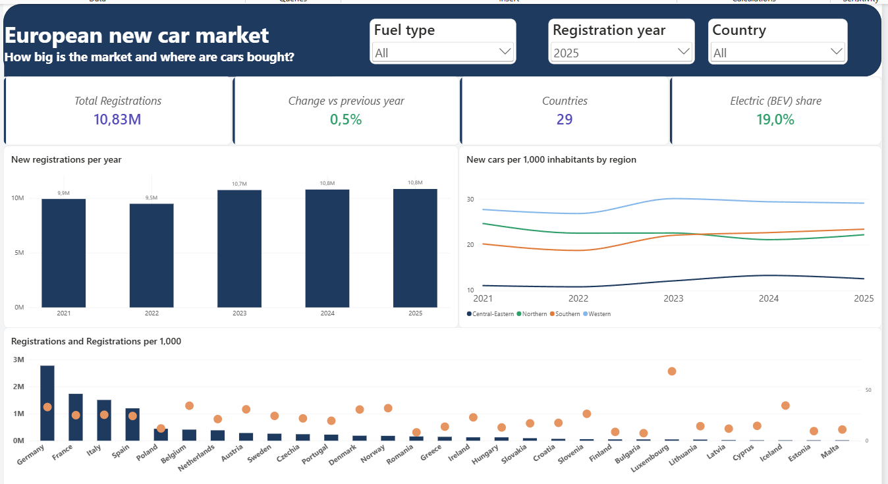
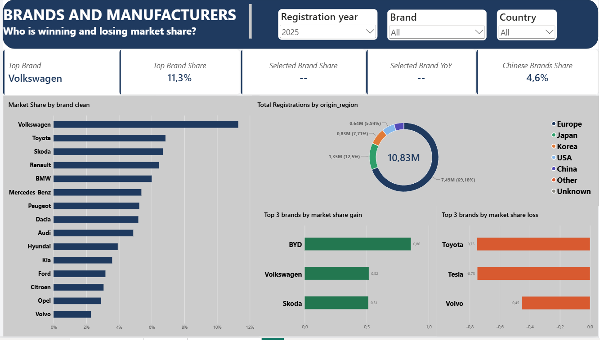
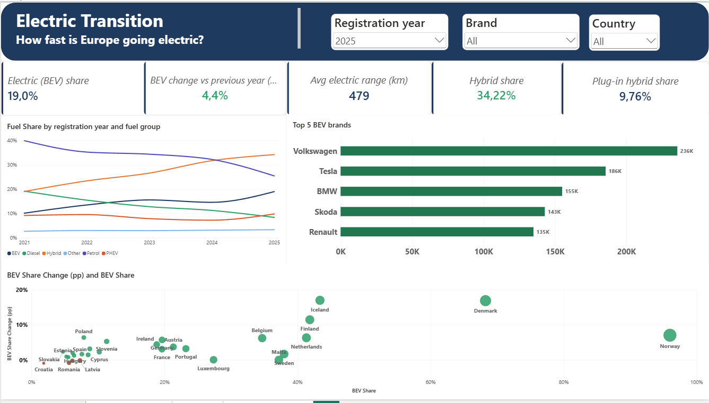

# European New Car Market 2021–2025

A Power BI report on new passenger car registrations in the EU27, Iceland and Norway, built on the official EEA CO2 monitoring data (51.7M vehicle records).

**Tools:** Python (pandas) · SQL Server · Power BI (DAX)



## Key findings
- **Electric cars almost doubled their share.** BEVs went from 10.1% of new cars in 2021 to 19.0% in 2025. Norway is close to 100%.
- **Hybrids overtook petrol** in 2024 and reached 34% of the market in 2025.
- **Volkswagen leads** with 11.3% of the market. In 2025, BYD gained the most share, while Toyota, Tesla and Volvo lost the most.
- **Chinese brands reached 4.6%** of registrations in 2025.
- **Central-Eastern Europe buys far fewer new cars:** about 11 per 1,000 inhabitants, compared with 20–30 in the rest of Europe.

## Report pages
| Page | Question |
|---|---|
| Market overview | How big is the market, and where are cars bought (total and per capita)? |
| Brands and manufacturers | Who leads, and who is winning or losing market share? |
| Electric transition | How fast is the fuel mix changing, and which countries lead? |

<p>


</p>

## Pipeline
```
EEA CSV downloads (51.7M rows)
  → python/group_downloaded_cars.py   aggregate to 168K rows
  → python/load_to_sql.py             raw_cars table (all text)
  → sql/page1_model.sql               fact_registrations, dim_country, dim_fuel
  → sql/page2_brands.sql              dim_brand
  → python/load_population.py         Eurostat population, for per-capita figures
  → Power BI                          star schema + DAX measures
```

## Data cleaning highlights
- **Brand names:** about 1,100 raw spellings (`VOLKSWAGEN VW`, `VOLKSWAGEN, VW`, `VW`…) are mapped to 89 brands and 53 manufacturer groups with prioritised `LIKE` rules. 99.9% of registrations map to a known brand.
- **Fuel groups:** non-plug-in hybrids are stored as petrol or diesel in the source (fuel mode `H`), so fuel type and fuel mode are combined into BEV / PHEV / Hybrid / Petrol / Diesel.
- **Averages:** CO2, mass, power and range are stored as sums plus counts, so averages are correctly weighted at every level.
- **Validation:** yearly totals were checked at each step (Python → SQL → Power BI) and against ACEA market figures.

## Data sources
- [EEA – CO2 emissions from new passenger cars](https://co2cars.apps.eea.europa.eu/) (final data 2021–2024, provisional 2025)
- [Eurostat – Population on 1 January (tps00001)](https://ec.europa.eu/eurostat/databrowser/view/tps00001/default/table)

The raw files are not included because of their size. Download them from the EEA viewer, put them in `raw/`, and run the scripts in the order shown above.

## Limitations
- Covers new registrations only, not used-car imports.
- 2025 data is provisional.
- Luxembourg's per-capita figure is inflated by company and leasing cars registered there.
- About 0.07% of registrations belong to rare or unknown brands ("Other").
